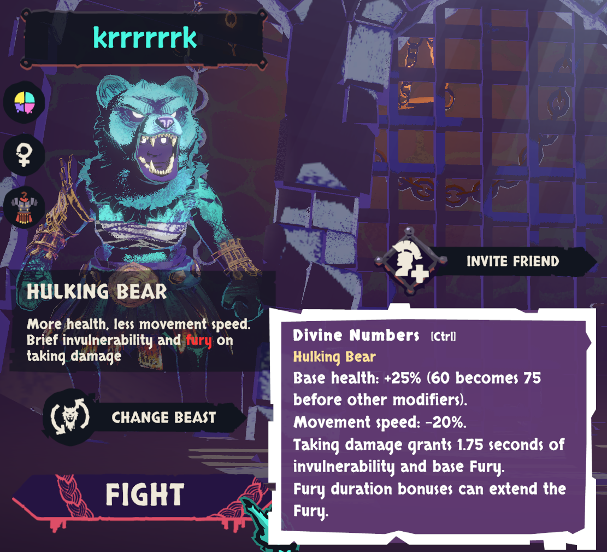
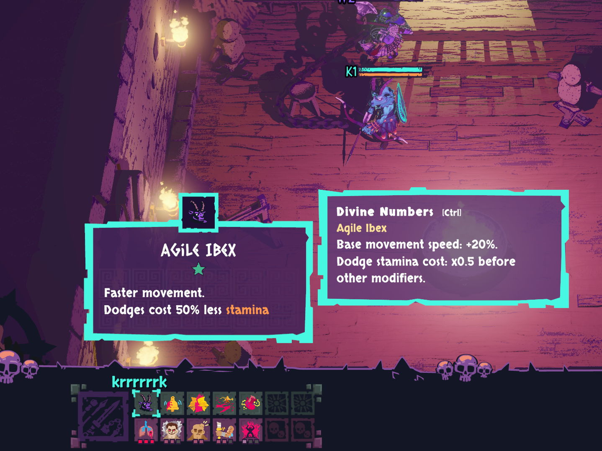
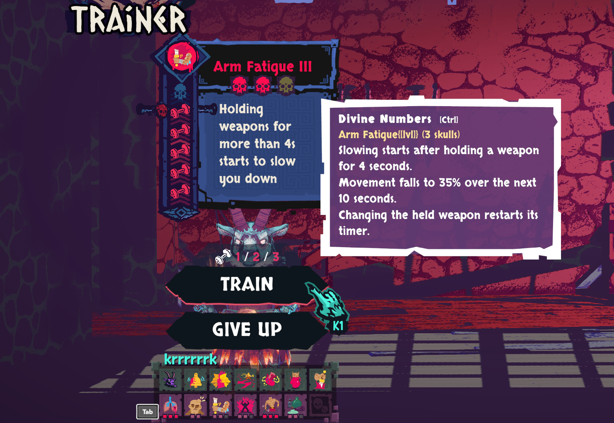
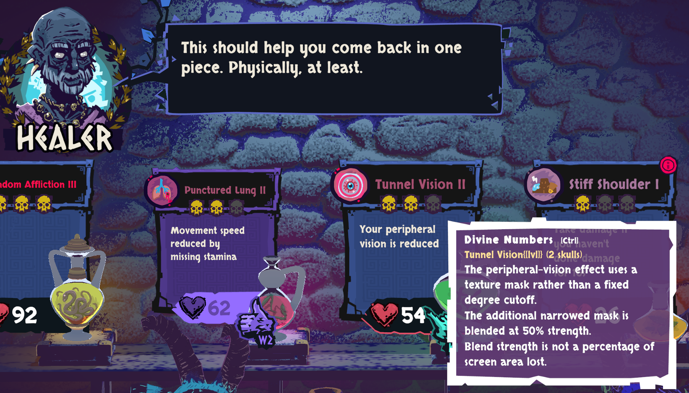

# Chained Beasts: Divine Numbers

A display-only BepInEx mod that shows researched numbers in a separate box while you hold **Ctrl**, or toggle it with **R3 (click the right stick)** on a controller. Original descriptions stay intact; **Shift keeps its normal status explanations**.

The **0.2.4 source update** connects R3 to the merchant's per-player purchase index, the trainer's affliction preview and the post-training skill-choice index. These menus suppress the unrelated HUD-skill fallback. The healer potion binding introduced in 0.2.3 remains. There are **206 cards**: 50 skills/beast variants, 134 affliction severity entries, 18 purchases and four statuses. It targets Steam build **26231777**. [Audit findings and limits](docs/audit-report.md) explain coverage and base values.

**Use 0.2.4 for the merchant and trainer controller bindings. The published 0.2.0 release has Ctrl support only.** The 0.2.4 update is built and packaged locally; it has not been published as a release yet.

On **character select**, highlight an unlocked supported variant and hold either Ctrl key. Character-info tooltips, hovered character-detail rows and selected/hovered trainer cards also work. In **potion/healer shops**, hold Ctrl anywhere over the combined sign and potion preview area, including the header, border, blank space, price, potion and pedestal. Surgery and Codex descriptions also support Ctrl while hovered. New labels may take up to half a second to register while Ctrl stays held. Release Ctrl to hide the box.

With a **controller**, click **R3** once. Numbers follow the native highlighted item or your character-select description, without using the mouse. From the collapsed bottom HUD, R3 inspects your first visible skill; hold **RB** to use the game's normal character-info navigation for other entries. Click R3 again to switch the numbers off. The toggle clears when all inspection contexts disappear, application focus is lost or its pad disconnects. It can remain on while returning to a visible HUD. Keyboard Ctrl remains independent. Rows without native controller focus still use mouse/Ctrl.

After the first launch, `BepInEx/config/local.chainedbeasts.divinenumbers.cfg` has an `[Input]` setting, `ControllerToggleButton`. Choose `RightStickClick` (default), `LeftStickClick`, or `Disabled`, then restart the game. Neither stick click appears in the audited game's default input bindings; custom remaps may differ.

The panel retains the smaller 22-point text and padding confirmed working by the user. R3 potion selection was confirmed working in 0.2.3. Merchant/trainer changes have build and offline regression checks and still need a manual runtime retest. Unknown/locked descriptions receive no guessed card. One training-only description has no confirmed native trip-duration branch and is recorded as unresolved.

## Screenshots

User-provided screenshots of 0.2.0 in play. These show the Ctrl panel; they do not demonstrate the new controller toggle or whole-card potion hover.

**Character select — Hulking Bear**



**Character info — Agile Ibex**



**Trainer — Arm Fatigue III**



**Healer — Tunnel Vision II**



## Build and install

Use the .NET SDK and the installed game's BepInEx IL2CPP interop files:

```powershell
dotnet build src/ChainedBeasts.DivineNumbers/ChainedBeasts.DivineNumbers.csproj -c Release
dotnet run --project tests/LogicChecks/LogicChecks.csproj -c Release
```

Download the ZIP from [GitHub Releases](https://github.com/Krrrrrrk/Chained-Beasts_Divine-Numbers/releases/latest) and, with the game closed, merge its `BepInEx` folder into the game folder. For a source build, copy `src/ChainedBeasts.DivineNumbers/bin/Release/net6.0/ChainedBeasts.DivineNumbers.dll` into `BepInEx/plugins/ChainedBeasts.DivineNumbers/`. Only this DLL is needed; there is no Foundation dependency. Remove it to uninstall. `scripts/build.ps1` builds, verifies and packages the ZIP (Python 3.11+ is required for provenance checks).

The mod checks the audited binary, metadata and two asset files before enabling UI hooks. A changed build disables it until re-audited. It changes no combat, saves or network traffic.

- [Card data and source references](data/numeric-details.json)
- [Coverage of registered definitions and localized training/status entries](data/coverage.json)
- [Build fingerprints, literals and asset facts](data/expanded-evidence.json)
- [Read-only verification](scripts/verify-catalog.py)
- [UI behavior and manual checks](docs/ctrl-details.md)
- [Original three-card research](docs/first-pass-findings.md)

Original game files, full localization catalogs and decompiler output are excluded from Git. The MIT license applies to this project's original work, not the game or its assets.
